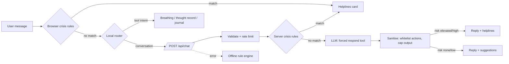

# MindEase

An AI mental wellness companion for teens and young adults. An LLM handles the conversation (default: Gemini Flash on Google's free tier); a deterministic safety layer runs before it, every time.

**Live demo:** _add your Vercel URL here_

[](https://vercel.com/new/clone?repository-url=https%3A%2F%2Fgithub.com%gaurisavale%2Fmindease&env=LLM_API_KEY&envDescription=Free%20Gemini%20API%20key%20for%20chat%20replies&envLink=https%3A%2F%2Faistudio.google.com%2Fapikey)

## What it does

- **AI companion chat.** CBT-informed replies from the LLM, with conversation memory, one practical technique per turn, and tappable next steps. Works in English, Hindi, Marathi and Hinglish.
- **Crisis detection that doesn't depend on the model.** Regex rules for self-harm and suicide phrases (English, Devanagari, Hinglish) run in the browser and again on the server. A match skips the model entirely and shows helplines.
- **Model as a second safety net.** Every reply carries a `risk_level` the model must set. `elevated` or `high` attaches helplines to the reply, catching indirect phrasing the rules miss ("everyone would be better without me").
- **Live NLP inspector.** A side panel shows each stage for the last message: tokens, lemmas, lexicon sentiment, crisis check, route, model output, latency and token usage.
- **Guided CBT thought record.** A deterministic six-step flow with thinking-trap detection (catastrophising, labelling, all-or-nothing...) and a before/after belief score.
- **Six self-check assessments**, including the validated PHQ-9 and GAD-7, with severity bands and tailored suggestions. PHQ-9 item 9 triggers crisis resources.
- **Tools:** paced breathing (box, 4-7-8, 4-6), affirmations, and a journal stored only in the browser.
- **Graceful degradation.** If the API is down or unconfigured, the chat falls back to a local rule-based engine and the header badge switches to "Offline".

## Architecture



| Layer | File | Notes |
|---|---|---|
| Frontend | `public/index.html` | Single file, no build step. Router, chat, assessments, tools, inspector. |
| API | `api/chat.js` | Vercel serverless function. Validation, rate limiting, safety short-circuit, model call, output sanitising. |
| LLM client | `lib/llm.js` | Zero-dependency OpenAI-compatible client. Forced named tool call, falls back to `required`, recovers JSON from plain text. |
| Safety | `lib/safety.js` | Crisis patterns and helplines. Shared contract with the browser copy. |
| Prompt | `lib/prompt.js` | System prompt and the `respond` tool schema (reply, intent, risk_level, suggestions). |
| Dev server | `scripts/dev.js` | Serves `public/` and the same handler locally. Mock mode needs no key. |
| Tests | `test/` | 32 tests: crisis true/false positives, validation, sanitising, handler paths, provider request format. |

**Why a forced tool call?** `tool_choice: respond` makes the model return structured JSON every time, so the server can read a risk level and validate suggested actions against a whitelist instead of parsing free text.

## Run locally

```bash
npm install
cp .env.example .env        # add LLM_API_KEY (free at aistudio.google.com/apikey)
npm run dev                 # http://localhost:3000
npm run dev:mock            # canned replies, no key needed
npm test
```

### Switching providers

Any OpenAI-compatible endpoint works. Set `LLM_BASE_URL`, `LLM_API_KEY` and `LLM_MODEL`:

| Provider | `LLM_BASE_URL` | Cost |
|---|---|---|
| Gemini (default, `gemini-3.8-flash`) | `https://generativelanguage.googleapis.com/v1beta/openai` | Free tier, Google account |
| Cerebras (`gpt-oss-120b`) | `https://api.cerebras.ai/v1` | Account setup may ask for a card |
| Groq (`openai/gpt-oss-120b`) | `https://api.groq.com/openai/v1` | Paid per token |
| Ollama | `http://localhost:11434/v1` | Free, local only |

The model must support tool calling.

## Deploy

1. Import this repo at [vercel.com/new](https://vercel.com/new) (framework preset: **Other**, no build command).
2. Add the environment variable `LLM_API_KEY` (get one free at [aistudio.google.com/apikey](https://aistudio.google.com/apikey)).
3. Deploy. Static files are served from `public/`, and `api/chat.js` becomes `/api/chat`.

On the free tier, heavy traffic hits the provider's rate limits; the chat then falls back to its offline rules rather than breaking.

## Safety and limits

MindEase is a supportive tool, not a medical device. It does not diagnose, and it is not a substitute for professional care. No accounts, and the app stores no conversations; messages are sent to the model provider only to generate a reply. Check your provider's data policy before going beyond a demo. The rate limiter is in-memory per function instance, which is fine for a demo but not for production abuse protection.

## Credits

Based on the B.Tech CSE capstone *MindEase: A Mental Health Chatbot* by Gauri Savale, Purva Thakare and Tanumay Chatterjee, guided by Dr. Sandeep Kumar, Symbiosis Institute of Technology, Nagpur (AY 2025–26). Full-stack AI rebuild by [Nileet Savale](https://nileetsavale.com).
